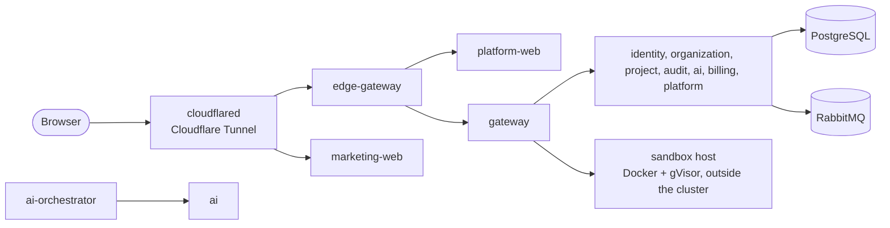

# Architecture

This repository holds only deployment definitions. Application code and image builds live in the `kuasarai` repository, whose CI opens pull requests here that change image digests. Argo CD applies what is on the branch it follows.

## Layers

```
base/                     cloud-neutral workloads: Deployments, Services, migration Jobs, NetworkPolicies, RabbitMQ, cloudflared
components/cloud-*/       what differs between clouds: storage class, managed-database port, pod network (kind, do, aws, gcp, azure)
components/<feature>/     opt-in features: external-secrets, observability, alerts, autoscaling, ingress
overlays/<env>/           what differs between environments: namespace, URLs, replicas, image digests, sandbox-host address
argocd/                   AppProject, ApplicationSet (staging + production), add-ons, the local Application
```

An environment on a cloud is `overlay + one cloud component`. `overlays/staging` and `overlays/production` currently include `cloud-do`. To run the same environment on another cloud, add a thin overlay on top (examples in the cloud guides): the component replaces the storage class and database port, everything else is shared.

## Runtime



The diagram shows the intended flow; the exact routes are defined by the images' own configuration (nginx and gateway), not by this repository. Verify against the app repo before relying on it.

- **Entry:** Cloudflare Tunnel (`cloudflared`) is the only door in staging and production. Pods labelled `kuasar.ai/edge-only` accept traffic only from it. Locally, kind port mappings and NodePorts replace it.
- **Data:** one PostgreSQL database per service with two roles each, an owner (used only by that service's migration Job) and an app role (used at runtime). Managed PostgreSQL in the cloud, an in-cluster pod locally.
- **Messaging:** RabbitMQ through the RabbitMQ cluster operator (1 node, 3 in production).
- **Sandbox:** customer code runs on a separate Linux host with Docker and gVisor, never in the cluster ([SANDBOX-HOST.md](SANDBOX-HOST.md)). The `sandbox` Service has no selector and an EndpointSlice points at the host; NodePort "bridge" Services let the host call back in.
- **Availability:** nodes and zones are spread softly, production uses surge rollouts and PodDisruptionBudgets, autoscaling and a native ingress are opt-in ([SCALING-AND-INGRESS.md](SCALING-AND-INGRESS.md)).
- **Network:** default-deny NetworkPolicies, then explicit allows (DNS, same namespace, database port, HTTPS egress, cloudflared, sandbox host).
- **Pods:** non-root, read-only root filesystem, no privilege escalation, dropped capabilities, resource requests and limits. `tools/check-policies.py` enforces this in CI, together with digest-pinned images.

## Sync order (Argo CD waves)

| Wave | What |
|---|---|
| 0 | ConfigMaps, Secrets, Services, volumes, RabbitMQ |
| 1 | migration Jobs (Argo "Sync" hooks, each with its own database owner login) |
| 2 | backend services |
| 3 | gateways and web |
| 4 | cloudflared |

The Jobs are Sync hooks, not PreSync, because PreSync would run before the ConfigMaps and Secrets they need exist.

## Environments

| Environment | Sync | Namespace | Notes |
|---|---|---|---|
| local | automatic, branch `local` | `kuasar-local` | generated branch: `main` plus staging digests (`sync-local.yml`) |
| staging | automatic | `kuasar-staging` | digests set by the app repo's CI |
| production | manual (release manager) | `kuasar-production` | 2 replicas for stateless services, PodDisruptionBudgets, 3-node RabbitMQ |

## Background documents

The original plans are in the `kuasarai` repository under `docs/operations/`: `cicd-kubernetes-argocd-plan.md`, `production-kubernetes-argocd.md`, `local-multi-machine-plan.md`, `production-readiness-review.md`, `blocker-solutions.md`. Anything operators need day to day is summarised in this repository.
